# Gas Plasma

[](https://github.com/JohnThre/GasPlasma-theme/actions/workflows/ci.yml)
[](https://github.com/JohnThre/GasPlasma-theme/actions/workflows/pages.yml)
[](https://open-vsx.org/extension/jpfchang/gas-plasma-theme)

Gas Plasma is an orange-dominant theme for Apple Terminal, iTerm2, VS Code, Open VSX-compatible editors, and Zed. It comes in **dark** (`Gas Plasma`), **light** (`Gas Plasma Light`), and **auto** (follow the OS appearance) variants, plus **color-blind-friendly** dark and light variants (`Gas Plasma Color Blind`, `Gas Plasma Color Blind Light`), with matching light and dark file icons.

The project ships one shared palette across terminal profiles, VS Code and Zed color themes, VS Code and Zed file icon themes, a VS Code product icon theme, a generated logo, and a generated documentation site.

<picture>
  <source media="(prefers-color-scheme: light)" srcset="assets/mockup-light.png">
  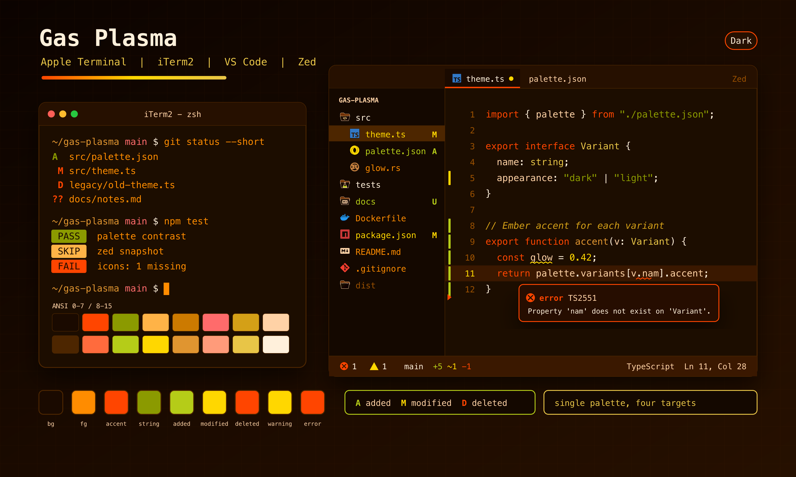
</picture>

## Contents

- [Install](#install)
- [Color Blind Variants](#color-blind-variants)
- [Screenshots](#screenshots)
- [Theme Package](#theme-package)
- [Architecture](#architecture)
- [Development](#development)
- [Release](#release)
- [Attribution](#attribution)
- [Donation](#donation)

## Install

### Apple Terminal

1. Download `GasPlasma.terminal` (dark), `GasPlasma-Light.terminal` (light), or the color-blind profiles `GasPlasma-ColorBlind.terminal` / `GasPlasma-ColorBlind-Light.terminal` from this repository or the latest GitHub Release.
2. Open each file to import the profile into Terminal.
3. Set "Gas Plasma", "Gas Plasma Light", or a "Gas Plasma Color Blind" profile as the default profile from **Terminal > Settings > Profiles** if desired.

Manual import: **Terminal > Settings > Profiles > ... > Import...** and select the `.terminal` file.

Apple Terminal profiles cannot follow the system appearance on their own, so there is no auto profile; switch between the two profiles manually.

### iTerm2

| Preset | Variant |
|---|---|
| `GasPlasma.itermcolors` | Dark |
| `GasPlasma-Light.itermcolors` | Light |
| `GasPlasma-Auto.itermcolors` | Auto: dark and light colors that follow the macOS appearance (iTerm2 3.5+) |
| `GasPlasma-ColorBlind.itermcolors` | Color blind, dark |
| `GasPlasma-ColorBlind-Light.itermcolors` | Color blind, light |
| `GasPlasma-ColorBlind-Auto.itermcolors` | Color blind, auto (iTerm2 3.5+) |

1. Download a preset from this repository or the latest GitHub Release.
2. Open **iTerm2 > Settings > Profiles > Colors**.
3. For auto, enable **Use separate colors for light and dark mode** first.
4. Choose **Color Presets... > Import...**, select the file, then select it from **Color Presets...**.

### VS Code and Open VSX

Install the published extension:

```bash
code --install-extension jpfchang.gas-plasma-theme
```

Or install a local VSIX from a GitHub Release:

```bash
code --install-extension jpfchang.gas-plasma-theme-0.1.0.vsix
```

Extension id: `jpfchang.gas-plasma-theme`

After installation, enable the companion icon themes from the command palette:

- **Preferences: File Icon Theme** > `Gas Plasma Icons`
- **Preferences: Product Icon Theme** > `Gas Plasma Product Icons`

Pick `Gas Plasma` (dark), `Gas Plasma Light`, `Gas Plasma Color Blind`, or `Gas Plasma Color Blind Light` from **Preferences: Color Theme**. The file icon theme switches to its light icons automatically whenever a light color theme is active, and product icons take their color from the active theme.

For auto, let VS Code follow the OS appearance:

```jsonc
// settings.json — follow the OS appearance
"window.autoDetectColorScheme": true,
"workbench.preferredDarkColorTheme": "Gas Plasma",
"workbench.preferredLightColorTheme": "Gas Plasma Light",
"workbench.iconTheme": "gas-plasma-icons"
```

### Zed

Install `Gas Plasma Theme` and `Gas Plasma Icons` from the Zed extensions store after the marketplace PR has been reviewed and merged.

Both extensions contain dark and light variants: `Gas Plasma` / `Gas Plasma Light` (plus `Gas Plasma Color Blind` / `Gas Plasma Color Blind Light`) and `Gas Plasma Icons` / `Gas Plasma Icons Light`. For auto, follow the system appearance in `settings.json`:

```json
{
  "theme": { "mode": "system", "dark": "Gas Plasma", "light": "Gas Plasma Light" },
  "icon_theme": { "mode": "system", "dark": "Gas Plasma Icons", "light": "Gas Plasma Icons Light" }
}
```

For local testing, install each generated extension directory as a Zed dev extension:

- `zed/gas-plasma-theme`
- `zed/gas-plasma-icons`

## Color Blind Variants

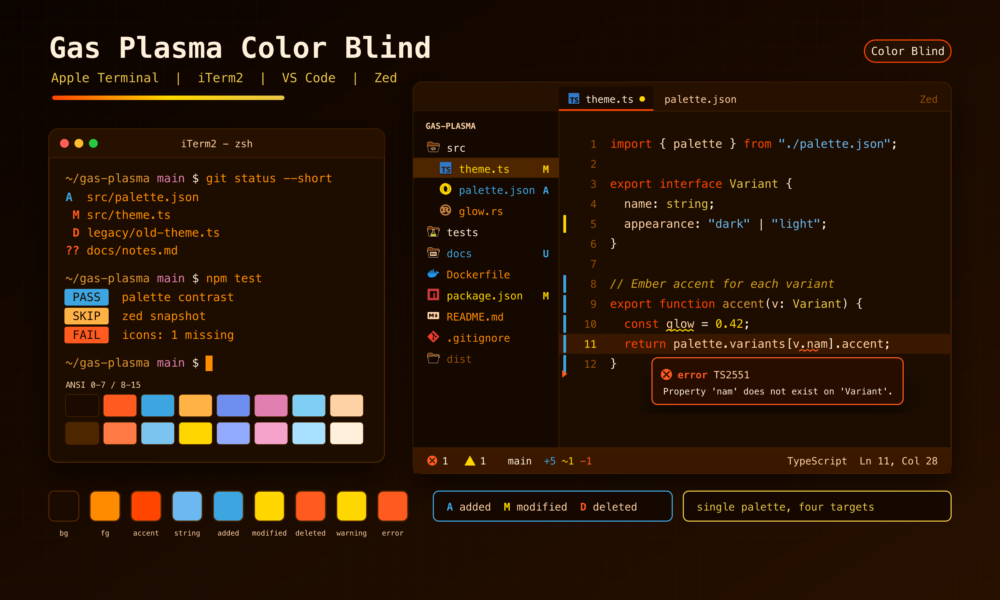

`Gas Plasma Color Blind` and `Gas Plasma Color Blind Light` keep the orange background, text, and accent, but take every status signal off the red/green axis, using an Okabe-Ito-style orange/blue contrast:

| Signal | Gas Plasma | Color Blind |
|---|---|---|
| Added lines, untracked files, success, passing tests | yellow-green | blue |
| Deleted lines, errors, failing tests | red | vermillion |
| Modified lines, warnings | yellow | yellow |
| Merge conflicts | coral | pink |
| Strings | olive | sky blue |
| ANSI green / bright green | olive / yellow-green | blue / sky blue |

To follow the OS appearance with the color-blind variants, use `GasPlasma-ColorBlind-Auto.itermcolors` in iTerm2, or in VS Code set `workbench.preferredDarkColorTheme` / `workbench.preferredLightColorTheme` to the two Color Blind themes. In Zed, use them as `dark` / `light` in the `theme` setting.

`npm run check` simulates protanopia, deuteranopia, and tritanopia (Machado et al. 2009, full severity). It fails the build when added/deleted, error/warning/success, ANSI red/green, or strings/keywords become too similar (OKLab ΔE). Status colors must also keep 3:1 contrast against the editor background. The original `Gas Plasma` and `Gas Plasma Light` themes also separate added/deleted and error/success by brightness, so they stay readable with red-green color blindness, but the Color Blind variants are the better fit.

## Screenshots

Captured from the real apps with the generated presets and extensions (`npm run screenshots`).

| | Zed | iTerm2 |
|---|---|---|
| Gas Plasma | 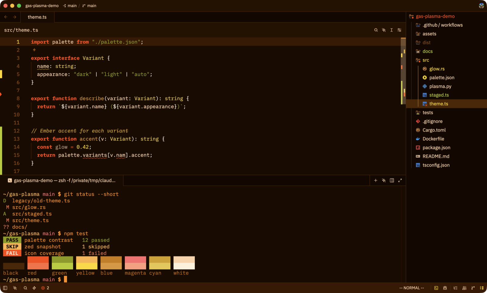 | 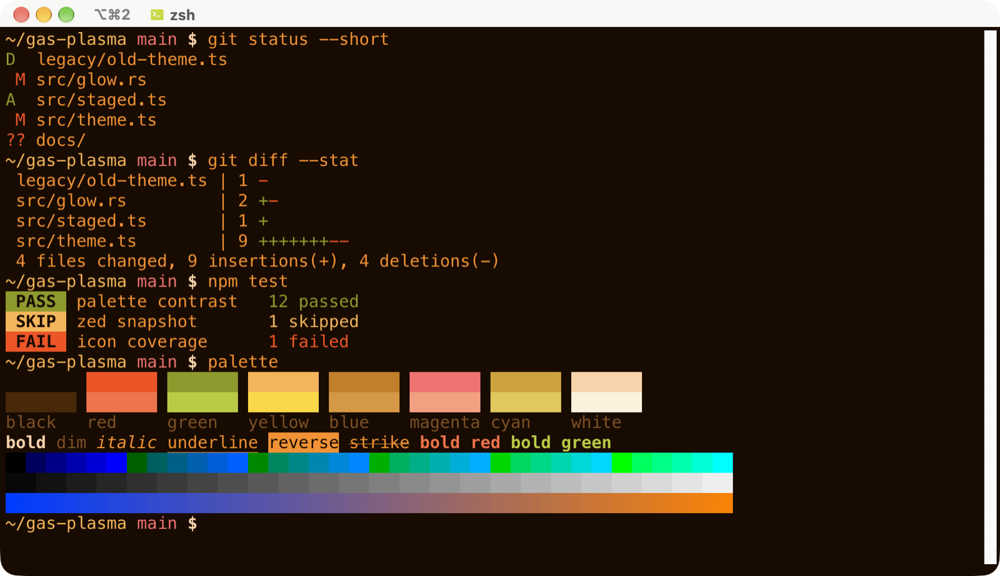 |
| Gas Plasma Light | 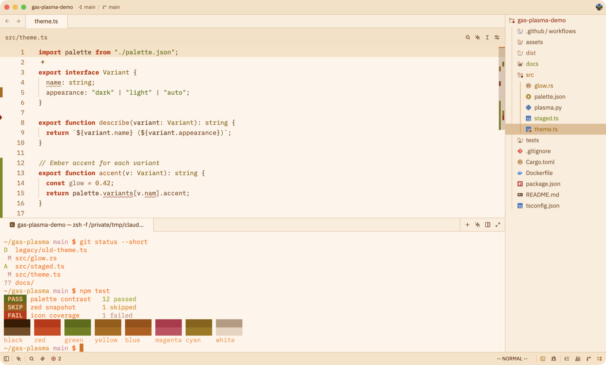 | 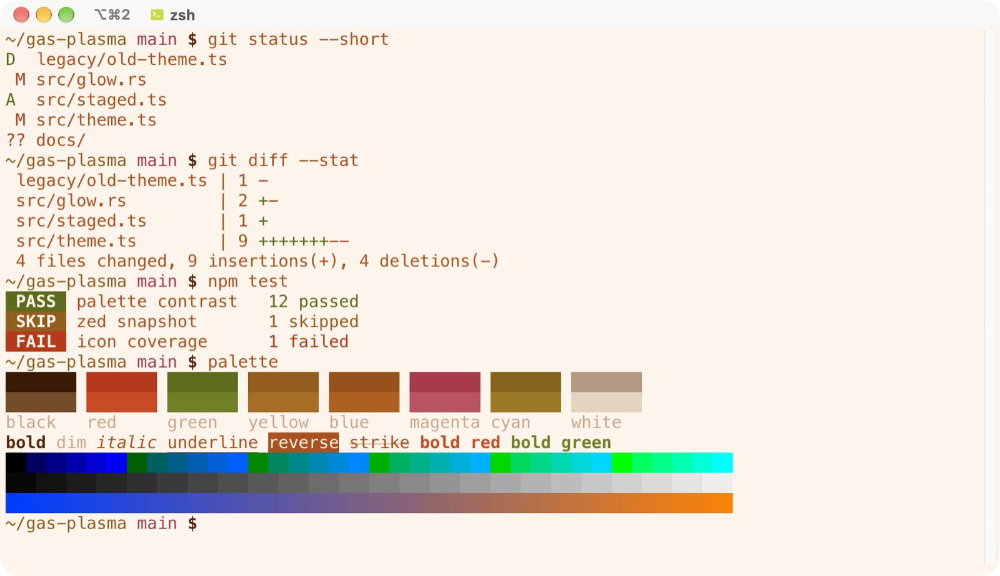 |
| Gas Plasma Color Blind | 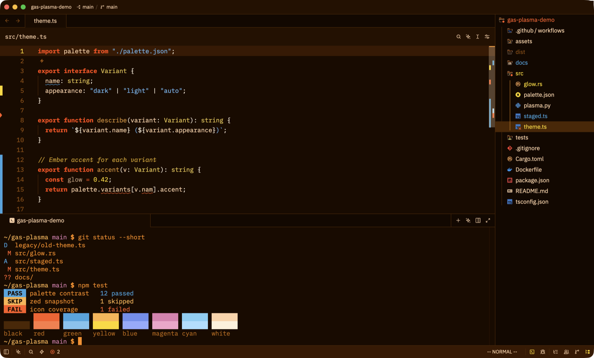 | 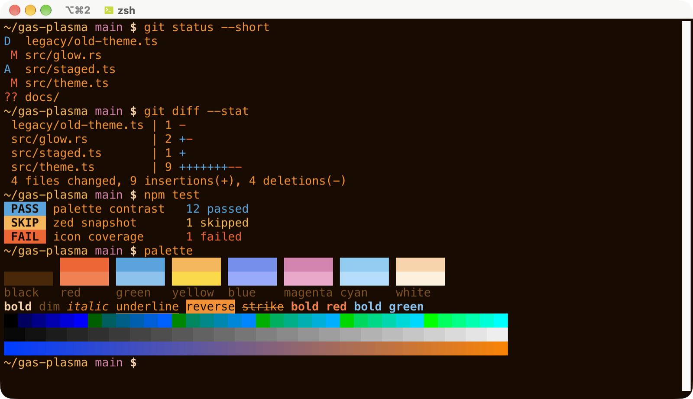 |
| Gas Plasma Color Blind Light | 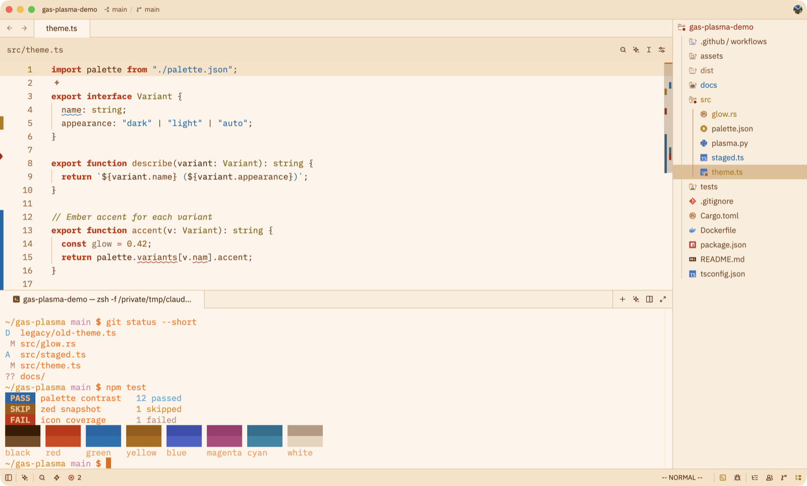 | 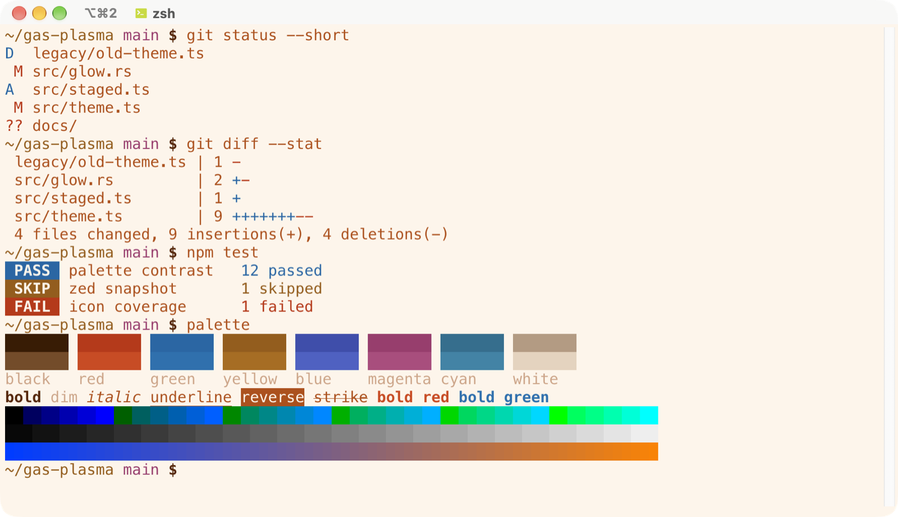 |

## Theme Package

| Asset | Purpose | Source |
|---|---|---|
| `GasPlasma.terminal`, `GasPlasma-Light.terminal`, `GasPlasma-ColorBlind*.terminal` | Apple Terminal profiles | `generate-theme.swift`, `src/palette.json` |
| `GasPlasma.itermcolors`, `GasPlasma-Light.itermcolors`, `GasPlasma-Auto.itermcolors`, `GasPlasma-ColorBlind*.itermcolors` | iTerm2 color presets (dark, light, auto, color blind) | `scripts/build.mjs`, `src/palette.json` |
| `themes/gas-plasma*-color-theme.json` | VS Code color themes (dark, light, color blind, color blind light) | `scripts/build.mjs`, `src/palette.json` |
| `icons/file/gas-plasma-icon-theme.json` | VS Code file icon theme (`svg/` dark, `svg-light/` light) | `scripts/build.mjs`, `src/icon-manifest.json` |
| `icons/product/gas-plasma-product-icon-theme.json` | VS Code product icon theme | `scripts/build.mjs`, `@vscode/codicons` |
| `zed/gas-plasma-theme/` | Zed color theme extension (all four variants) | `scripts/build.mjs`, `src/palette.json` |
| `zed/gas-plasma-icons/` | Zed file icon theme extension (dark + light) | `scripts/build.mjs`, `src/icon-manifest.json` |
| `assets/logo.*`, `assets/mockup.*`, `docs/index.html` | Brand and documentation assets | `scripts/build.mjs` |

`src/palette.json` defines the `dark`, `light`, `colorblind`, and `colorblindLight` variants (core, ANSI, UI surface, syntax, and `semantic` status colors for git, diff, and diagnostics). Light file icons are derived from the dark artwork at build time: warm neutrals are mirrored in lightness and accents are deepened until they keep at least 3:1 contrast on the light tile.

File icons use recognizable upstream language and ecosystem logo geometry where available, with restrained Gas Plasma color treatment for contrast. Product icons are generated from VS Code Codicons to preserve the original editor UI icon language.

Language coverage includes C, C++, Objective-C, Pascal, Python, Vala, C#, Java, PHP, Go, Swift, JavaScript, TypeScript, HTML, CSS, Rust, Ruby, Dart, Kotlin, Scala, Lua, R, Zig, Perl, Haskell, Elixir, Erlang, Clojure, F#, SQL, Vue, Svelte, PowerShell, Terraform/HCL, Nix, Julia, Fortran, Ada, COBOL, assembly, Groovy, Crystal, Nim, OCaml, Reason, Elm, MATLAB, VB, Verilog/VHDL, LaTeX, GraphQL, WASM, Astro, Pug, Handlebars, EJS, Racket, Gleam, Haxe, Prisma, Solidity, CUDA, Typst, React, Sass, Less, Stylus, and PostCSS.

Tooling coverage includes ESLint, Prettier, EditorConfig, Babel, Vite, Vitest, Jest, webpack, Rollup, Biome, Tailwind CSS, Node.js, Bun, Deno, pnpm, Yarn, Poetry, uv, Ruff, pytest, Gradle, Maven, Bazel, Kubernetes, Helm, Ansible, GitHub Actions, GitLab CI, Jenkins, NGINX, Netlify, Vercel, and Cloudflare Wrangler, plus generic icons for tests, notebooks, binaries, spreadsheets, slides, diffs, certificates, shaders, 3D models, logs, and environment files.

Named folders (`src`, `tests`, `.github`, `components`, `node_modules`, and about 100 more) use folder-shaped icons with an emblem and a distinct open state.

## Architecture

The repository is organized so generated files can be reproduced from source data and scripts.

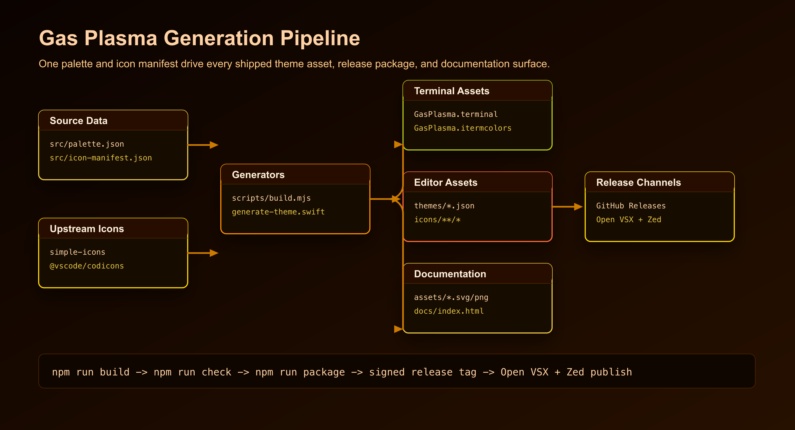

The generated site lives in `docs/` for GitHub Pages. The extension package intentionally excludes build sources, docs sources, local editor metadata, and AI-assistant local state through `.vscodeignore`.

## Development

Requirements:

- macOS 26.4 or later for Apple Terminal profile generation.
- Node.js 22 or later for extension packaging and generated assets.
- Swift 6 or later with Xcode command-line tools for `GasPlasma.terminal`.

Install dependencies and rebuild every generated asset:

```bash
npm ci
npm run build
npm run check
```

Recapture the real iTerm2 and Zed screenshots in `assets/screenshots/` (macOS; needs Screen Recording and Accessibility permission for your terminal, and the Zed extensions installed as dev extensions):

```bash
npm run screenshots            # or: npm run screenshots -- iterm2 | zed
```

Create a local VSIX package:

```bash
npm run package
```

Primary source files:

- `src/palette.json` controls shared colors.
- `src/icon-manifest.json` controls file, folder, language, and product icon mappings.
- `scripts/build.mjs` generates iTerm2, VS Code, Zed, icon, logo, mockup, architecture, and GitHub Pages assets.
- `generate-theme.swift` generates the Apple Terminal profile because Terminal stores colors as archived AppKit color data.
- `scripts/check.mjs` validates generated assets, WCAG contrast, color-vision-deficiency distinguishability, and release packaging assumptions.
- `scripts/lib/color.mjs` holds the shared contrast, CVD simulation, and OKLab math.

## Release

Releases are designed to start from signed `v*` tags. The release workflow verifies the tag signature, builds artifacts, signs `SHA256SUMS` with GPG key `FEA322F2C85C0E17`, creates a GitHub Release, publishes the VSIX to Open VSX, and opens or updates a PR against `zed-industries/extensions` for the Zed marketplace entries.

To cut a release, bump `version` in `package.json`, add a `CHANGELOG.md` entry, push to `main`, then run the **Create Signed Release Tag** workflow with that version. It creates and pushes the signed tag and then starts the release workflow on it automatically. Pushing a signed `v*` tag yourself also starts the release.

Required repository secrets:

- `GPG_PRIVATE_KEY`
- `GPG_PASSPHRASE`
- `OVSX_PAT`
- `COMMITTER_TOKEN` with access to push to the Zed extensions fork and open PRs

Open VSX namespace: `jpfchang`

If the namespace does not exist when the release workflow runs, the workflow attempts to create it with `ovsx create-namespace`. For verified namespace ownership, follow the Open VSX namespace access guide:

https://github.com/eclipse-openvsx/openvsx/wiki/Namespace-Access

Zed marketplace fork: `JohnThre/extensions` by default. Set the repository variable `ZED_EXTENSIONS_FORK` to another fork in `owner/repo` format if the marketplace fork lives elsewhere.

Zed marketplace publication is controlled by the official `zed-industries/extensions` review flow. The release workflow automates the submodule/version update PR; the extension appears in the store after that PR is merged by Zed maintainers.

## Attribution

- File icon source geometry uses [Simple Icons](https://simpleicons.org/) where available. Simple Icons is licensed under CC0-1.0.
- Product icon source geometry uses [VS Code Codicons](https://github.com/microsoft/vscode-codicons), licensed under CC-BY-4.0.
- Gas Plasma generated artwork, theme files, and repository code are licensed under GPL-3.0-or-later.

## Security

Report vulnerabilities through GitHub Security Advisories when available. See [SECURITY.md](SECURITY.md).

## Donation

<a href="https://nowpayments.io/donation?api_key=5792a927-dd7d-4b0c-982b-584a7499ffc9" target="_blank" rel="noreferrer noopener">
    
</a>

<a href="https://nowpayments.io/donation?api_key=5792a927-dd7d-4b0c-982b-584a7499ffc9" target="_blank" rel="noreferrer noopener">
    
</a>

## License

[GNU General Public License v3.0](LICENSE)
